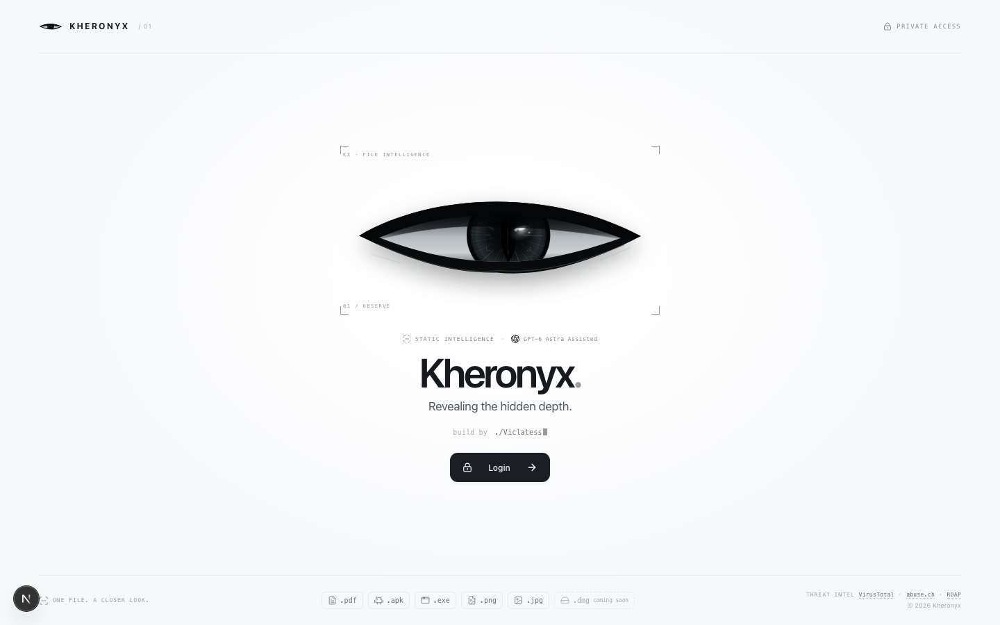
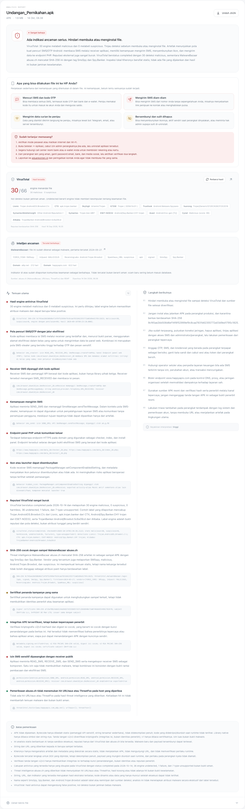
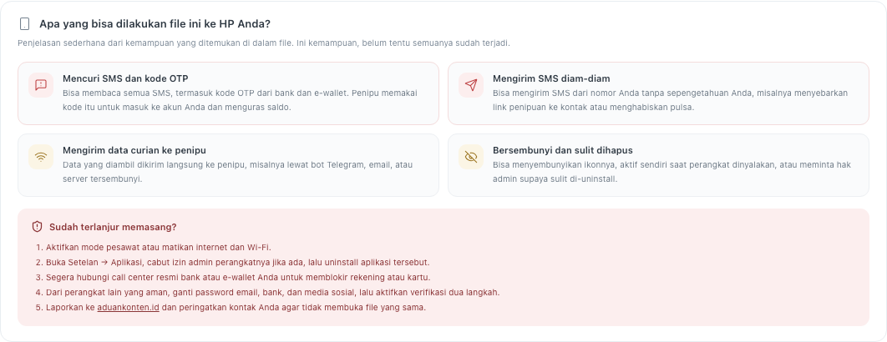
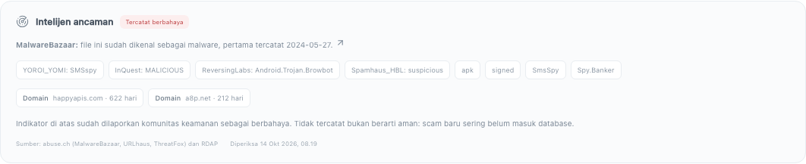
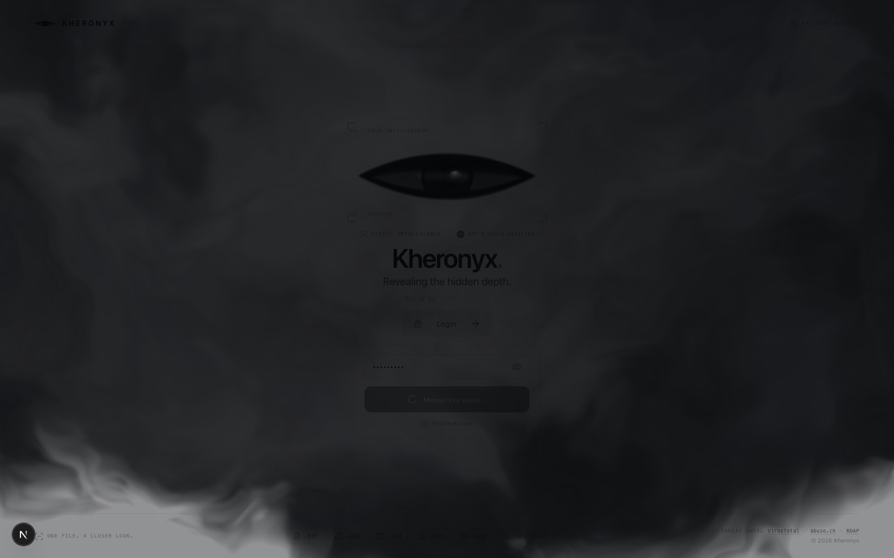
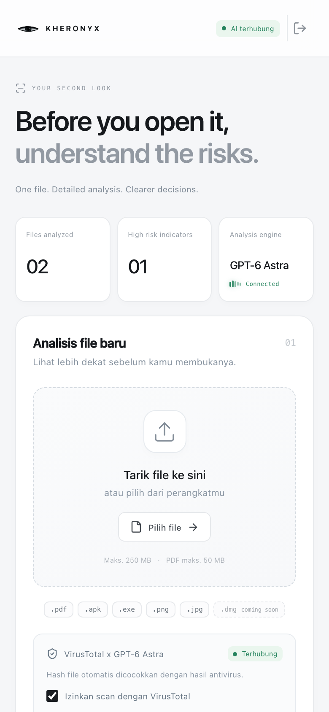
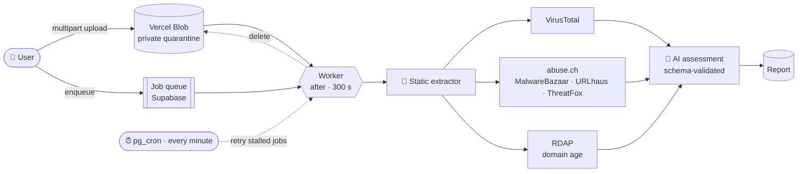

<div align="center">


# Kheronyx

### 👁️ Revealing the hidden depth.

**AI-assisted static file intelligence for unmasking scam APKs, malicious EXEs and weaponized PDFs. It never runs the file.**

<a href="https://kheronyx.vercel.app"></a>


<br/>


<br/><br/>



</div>

---

## 🧭 Why Kheronyx?

In Indonesia, scams arrive as harmless-looking files: *"Undangan Pernikahan.apk"*, *"Cek Resi Paket.apk"*, *"Tagihan PLN.pdf"*. Once installed, these apps quietly read your SMS, grab your banking OTP and forward it to a Telegram bot.

Kheronyx lets anyone **look inside a file before opening it**. It takes the file apart byte by byte, checks it against global threat intelligence, and has an AI explain the risk in plain Bahasa Indonesia: **Aman · Waspada · Bahaya · Sangat bahaya**.

> [!IMPORTANT]
> Kheronyx performs **static analysis only**. Uploaded files are parsed, never executed. A clean result is never a guarantee of safety, and the app says so in every report.

## ✨ Highlights

| | |
|---|---|
| 🔬 **Deep static dissection** | Dalvik bytecode, binary XML manifests, signing blocks, ELF/PE/.NET metadata and PDF object streams are all parsed in pure TypeScript, with every parser bounded and fuzz-tested. |
| 🕵️ **Built for scam APKs** | Detects SMS/OTP stealers, Telegram-bot exfiltration, accessibility-abusing banking trojans, overlays, hidden icons, droppers and ~19 Android packers. |
| 🧬 **Knows who called what** | Decoded call sites tell app code from libraries, e.g. *"`SmsReceiver.onReceive` reads SMS **and** sends it to the panel"*. |
| 🧩 **Sees through tricks** | BadPack ZIP headers, empty `classes.dex`, zeroed manifest headers, XOR/base64/char-array string hiding, repackaged APKs (v2/v3 signature verification). |
| 🛰️ **Threat intelligence** | VirusTotal reputation, abuse.ch **MalwareBazaar / URLhaus / ThreatFox** lookups, and **RDAP** domain age for every server found inside the file. |
| 🧑‍🤝‍🧑 **Made for non-experts** | Every report translates technical findings into plain consequences (*"can read your OTP codes and drain your account"*) plus emergency steps if the app was already installed. |
| 🤖 **AI verdict, with guardrails** | A schema-validated LLM report that must cite extracted evidence. Missing evidence can never produce a "safe" verdict. |
| 🔗 **Campaign tracking** | Signer certificate SHA-256 values and redacted bot IDs link samples from the same scam actor. |
| ☁️ **Close the tab, keep the job** | Analyses run as durable background jobs with automatic retries (Supabase `pg_cron`) and can be cancelled. |
| 🌫️ **Cinematic UX** | A WebGL fractal-noise smoke transition pours out from behind the landing eye. |

## 📸 A real scam APK, dissected

A real **SMSspy** sample from MalwareBazaar, renamed the way victims receive it:

<div align="center">

</div>

<div align="center">

<br/><sub>What the file can do to your phone, explained for everyone, with emergency steps</sub>
</div>

<table>
<tr>
<td width="50%"></td>
<td width="25%"></td>
<td width="25%"></td>
</tr>
<tr>
<td align="center"><sub>abuse.ch + RDAP intelligence</sub></td>
<td align="center"><sub>Smoke login transition</sub></td>
<td align="center"><sub>Responsive dashboard</sub></td>
</tr>
</table>

## 🎯 Measured on real malware

Measured with `scripts/eval-corpus.mts` on real samples from [MalwareBazaar](https://bazaar.abuse.ch). The run used the static extractor only, with no AI, no VirusTotal, and nothing executed:

| Family | Samples | 🔴 High / critical | 🟠 At least medium | Parse failures | Avg time |
|---|:-:|:-:|:-:|:-:|:-:|
| **SMSspy** (SMS/OTP stealers) | 30 | **93%** | **100%** | 0% | 91 ms |
| **SpyNote** (Android RAT / banker) | 15 | **100%** | **100%** | 0% | 87 ms |

The first run exposed four real-world anti-analysis tricks: empty `classes.dex`, BadPack compression IDs, manifests with lying ZIP sizes, and poisoned string pools. Each is now handled and covered by tests.

## 🔬 How it works



1. **Upload**: the browser streams the file straight into a private Vercel Blob store (multipart, live `17 / 48 MB` progress). Up to **250 MB**, PDFs up to 50 MB.
2. **Queue**: a job row is created and the worker starts in `after()`, so the user may close the tab.
3. **Dissect**: the extractor validates magic bytes, then parses the format (see below).
4. **Reputation**: VirusTotal and abuse.ch (hash, servers and URLs) are queried in parallel with RDAP domain ages.
5. **Assess**: only bounded evidence (never the raw file) goes to the LLM, whose JSON answer is validated with Zod.
6. **Clean up**: the quarantined file is deleted. Transient failures retry with backoff (30 s, 1 m, 2 m, 5 m), resumed by a Supabase `pg_cron` heartbeat.

## 🧬 What gets dissected

<details open>
<summary><b>📱 APK</b></summary>

- **Manifest**: permissions, components, intent filters, launcher visibility. Tolerates BadPack and corrupted string pools.
- **Every DEX**: string/type/method/class tables, plus **Dalvik bytecode decoding** for call sites (app code vs. known SDKs) and indirect subclasses.
- **Behaviors**: SMS read/send, OTP interception, accessibility, overlays, notification listeners, device admin, USSD call forwarding, hidden icon, APK installs, dynamic code loading, contacts, call logs, keyboard capture.
- **Exfiltration**: Telegram bot tokens (always redacted), Discord/Slack webhooks, PHP panels, raw-IP endpoints, Firebase.
- **Deobfuscation**: base64, hex, reversed, char/byte arrays, single-byte XOR, StringBuilder chains.
- **Packers**: Jiagu, Bangcle/SecNeo, ijiami, Legu and ~15 more, plus stub-only and empty-DEX detection.
- **Native code**: ELF `.so` symbols, JNI exports, embedded endpoints, anti-debug markers.
- **Signing**: v1/v2/v3 certificates, debug/test keys, and **cryptographic v2/v3 verification** to catch repackaged apps.
</details>

<details>
<summary><b>🪟 EXE / DLL</b></summary>

- PE32/PE32+ headers, sections, entropy, full import and delay-load tables, grouped into injection, keylogging, credential theft, download-and-execute and ransomware patterns.
- Resources: version info, manifest (admin elevation), embedded PE/scripts/archives, **brand impersonation** (claims "BCA" or "Microsoft" but isn't signed by them).
- **.NET metadata**: types, member refs, P/Invoke, user strings, stealer/RAT markers and obfuscators.
- Packers, installers and compilers (UPX, Themida, NSIS, Inno, PyInstaller, Go, …), Authenticode signer, overlay classification.
</details>

<details>
<summary><b>📄 PDF · 🖼️ PNG/JPG</b></summary>

- PDF.js (eval disabled): text, links and JavaScript from the first 30 pages, attachments, and `/OpenAction`, `/Launch`, `/AA`, `/SubmitForm` and `/RichMedia` inside compressed object streams.
- Images: chunk/segment structure and data appended after the image end. Pixels are never rendered.
</details>

## 🛡️ Security model

- 🔐 **Single-password access** with HMAC-signed sessions. Only *wrong* passwords count toward the 8-per-15-minutes lockout.
- 🧱 **No execution, ever.** Parsers are bounded in time, memory and recursion, and fuzzed with thousands of corrupted inputs.
- 🗄️ **Private by default**: private Blob store, RLS-locked Supabase tables, server-only secrets, strict CSP.
- 🙈 **Secret hygiene**: Telegram bot secrets are masked everywhere, even when parsing aborts midway.
- 🚦 **Fair use**: rate limits on analyses, uploads, VirusTotal, abuse.ch, RDAP and large files (to protect the Hobby Blob allowance).

## 🚀 Getting started

```sh
git clone https://github.com/MrPrinceAli/Kheronyx.git
cd Kheronyx
npm ci
cp .env.example .env   # fill in the values below
npm run dev
```

| Variable | Purpose |
|---|---|
| `ACCESS_PASSWORD` / `ACCESS_PASSWORD_HASH` | Login password (use the hash in production: `node scripts/password-hash.mjs`) |
| `SESSION_SECRET` | HMAC key for sessions |
| `AI_API_KEY`, `AI_BASE_URL`, `AI_MODEL`, `AI_FALLBACK_MODEL` | OpenAI-compatible gateway for the assessment |
| `BLOB_READ_WRITE_TOKEN` | Vercel Blob private store (enables 250 MB uploads and background jobs) |
| `SUPABASE_URL`, `SUPABASE_SERVICE_ROLE_KEY` | Reports, jobs, rate limits |
| `VIRUSTOTAL_API_KEY` | Hash reputation (optional upload) |
| `ABUSE_CH_AUTH_KEY` | MalwareBazaar, URLhaus, ThreatFox ([free key](https://auth.abuse.ch)) |
| `CRON_SECRET`, `JOBS_SECRET` | Daily maintenance and the per-minute job scheduler |

Apply the SQL in [`supabase/migrations`](supabase/migrations) to your project. The scheduler migration explains the shared Vault secret it needs.

## 🧪 Testing & evaluation

```sh
npm run typecheck
npm test            # 76 tests: parsers, fuzzing, signing, jobs, threat intel
npm run build

# Detection accuracy on real samples (never executed, stored read-only in .corpus/)
ABUSE_CH_AUTH_KEY=... npx tsx scripts/eval-corpus.mts fetch --tag SMSspy --limit 30
npx tsx scripts/eval-corpus.mts run .corpus/SMSspy
```

## 📁 Project structure

```
app/                 Next.js routes: landing, dashboard, API (uploads, jobs, reports, auth, cron)
components/          UI, WebGL smoke canvas, report panels
lib/
  extract.ts         Format dispatch, bounding and redaction
  dex.ts             DEX tables + Dalvik bytecode decoder
  behaviors.ts       Scam/banking-trojan behavior catalog
  apk-*.ts, elf.ts   Signing, packers, payloads, native libraries
  pe-*.ts, dotnet.ts PE imports/resources/packers, .NET metadata
  threat-intel.ts    abuse.ch + RDAP
  virustotal.ts      VirusTotal
  jobs.ts            Durable background jobs with retries
  ai.ts              LLM assessment with schema validation
scripts/             Corpus evaluation, env sync, password hashing
supabase/migrations  Tables, job claim function, pg_cron scheduler
tests/               node:test suites incl. fuzzing and real-world trick fixtures
```

## ⚠️ Disclaimer

Kheronyx is a research and awareness tool. Static analysis can miss malware that downloads or decrypts its payload at runtime, and antivirus/threat-intel absence is not proof of safety. Always install apps from official stores only. To report Indonesian scams, use [aduankonten.id](https://aduankonten.id) and your bank's official channels.

## 🙏 Acknowledgements

[VirusTotal](https://www.virustotal.com) · [abuse.ch](https://abuse.ch) (MalwareBazaar, URLhaus, ThreatFox) · [RDAP](https://about.rdap.org) · [PDF.js](https://mozilla.github.io/pdf.js/) · [Vercel](https://vercel.com) · [Supabase](https://supabase.com)

<div align="center">

**Built with 🖤 by [Viclatess](https://github.com/MrPrinceAli)**

<sub>If Kheronyx helped you, consider leaving a ⭐. It helps more people find it.</sub>

</div>
